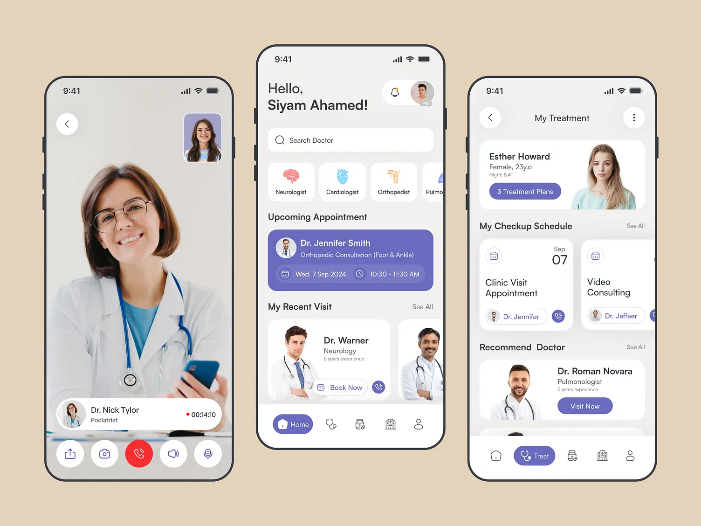
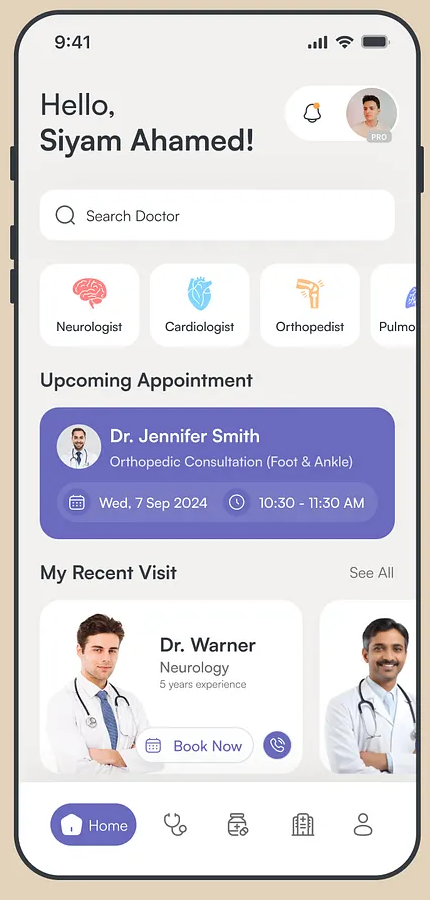
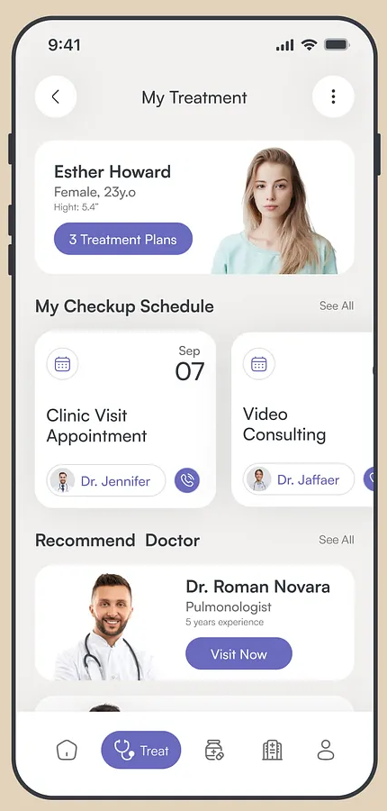
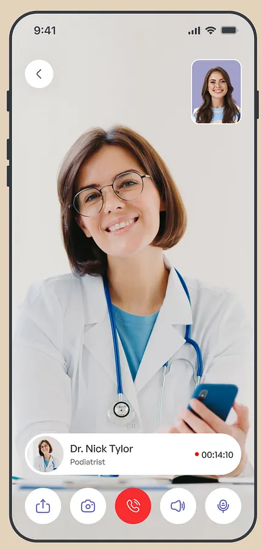

# CarePulse Doctor

A modern **Telehealth & Doctor Appointment Android Application** built with **Kotlin**, **Jetpack Compose**, and **Material Design 3**, featuring a calm healthcare aesthetic, multi-screen navigation, and a dedicated **real-time mock data layer** (no backend required).


-28B478?style=flat-square)


---

## Screen Showcase

<p align="center">
  
</p>

| Home Dashboard | My Treatment | Live Video Consultation |
| :---: | :---: | :---: |
|  |  |  |
| Personalized greeting, unread badge, live doctor search, specialty filters, indigo upcoming appointment card & recent visits. | Active patient summary card, treatment plans progress sheet, horizontal checkup schedule & recommended specialists. | Edge-to-edge full-screen consultation feed, PiP self-view camera toggle, live ticking timer & 5 interactive call controls. |

---

## Design System

CarePulse Doctor uses a cohesive, calm clinical palette anchored on an alabaster-lavender canvas paired with high-contrast pure white cards and an indigo-violet primary accent.

### Color Tokens (`ui/theme/Color.kt`)

| Token | Hex | Usage |
| :--- | :--- | :--- |
| `AlabasterCanvas` | `#F6F4F8` | Primary screen canvas background |
| `PureWhiteSurface` | `#FFFFFF` | Elevated cards, search bar, bottom nav bar & call pill |
| `IndigoPrimary` | `#5D59BC` | Active navigation pill, primary CTAs, upcoming appointment card |
| `IndigoSoftContainer` | `#ECEBF9` | Selected specialty chips, medication & metric badges |
| `InkPrimary` | `#1A1927` | Primary headings & high-contrast body text |
| `SlateSecondary` | `#7B798B` | Subtitles, experience labels & muted metadata |
| `CoralRed` | `#E94235` | Video end-call button & live call indicator dot |
| `EmeraldLive` | `#28B478` | Doctor online dot, live clinic wait badges & completed states |
| `AmberBadge` | `#F5A623` | Unread notification indicator & star ratings |

### Specialty Category Accents

| Specialty | Accent Hex | Custom Vector Icon |
| :--- | :--- | :--- |
| **Neurologist** | `#EF6C6C` | Dual-hemisphere neural silhouette |
| **Cardiologist** | `#56B7EE` | Heart outline with ECG pulse wave |
| **Orthopedist** | `#F3A157` | Joint & bone articulation mark |
| **Pulmonologist** | `#7371D4` | Bronchial & lung pair mark |
| **Podiatrist** | `#39B2A8` | Foot care cross emblem |

### Typography & Spacing (`ui/theme/Type.kt`, `Theme.kt`)

- **Typeface:** Bundled **Plus Jakarta Sans** (`res/font/plus_jakarta_sans.ttf`) across Display, Headline, Title, Body, and Label scales.
- **Shape Language:** `24.dp` large cards, `22.dp` horizontal doctor/checkup cards, `18.dp` specialty tiles, and `50%` pill buttons & floating navigation highlights.
- **Grid & Accessibility:** Built on an `8.dp` spacing system with `minimumInteractiveComponentSize()` (`48.dp` minimum touch targets), edge-to-edge `WindowInsets` handling, and semantic `contentDescription` / `testTag` annotations.
- **Adaptive Layouts:** Automatically switches from the compact floating bottom pill bar (`FloatingBottomNavBar`) to a side `NavigationRail` on screens `>= 600.dp` wide, constraining content to `600.dp` max width for tablet and foldable ergonomics.

---

## Implemented Pages & Interactive Flows

1. **Home (`HomeScreen`)** — Live doctor search bar, interactive specialty category filters, indigo Upcoming Appointment card (tap for details/join call/cancel), My Recent Visit horizontal cards with `Book Now` & instant `Call` buttons, and notification inbox sheet.
2. **My Treatment (`TreatmentScreen`)** — Active patient profile (`Esther Howard` / switchable with `Siyam Ahamed`), expandable `3 Treatment Plans` progress modal, horizontal `My Checkup Schedule` cards, and `Recommend Doctor` cards with `Visit Now`.
3. **Medications (`PrescriptionsScreen`)** — Daily medication adherence summary, interactive `Mark Taken` dose toggles, and one-tap pharmacy `Refill` requests.
4. **Partner Clinics (`ClinicsScreen`)** — Partner clinic directory with live simulated wait-time updates every 10 seconds and direct clinic visit booking.
5. **Profile (`ProfileScreen`)** — Member PRO card with health metrics, instant podiatry video call shortcut (`Dr. Nick Tylor`), family treatment profile switcher, and reminder preferences.
6. **Specialist Directory (`DoctorDirectoryScreen`)** — Full searchable & filterable doctor catalog accessible from every `See All` action.
7. **Doctor Profile (`DoctorDetailScreen`)** — Full clinician bio, hospital affiliation, consultation fee, ratings, and `Book Now` / `Video Call` actions.
8. **Video Consultation (`VideoCallScreen`)** — Full-bleed video feed, top-right PiP self-view camera preview, live pulsing indicator + ticking `HH:MM:SS` duration counter, and interactive Share, Camera, Red End Call, Speaker, and Mic buttons.

---

## Architecture & Mock Real-Time Data Folder

The app follows **MVVM + Repository** architecture using Kotlin Coroutines and `StateFlow`, powered locally with zero backend dependencies:

```text
app/src/main/java/com/example/
├── data/
│   ├── mock/                         # Dedicated real-time mock data folder
│   │   ├── MockModels.kt             # Domain models (Doctor, Appointment, Checkup, etc.)
│   │   └── MockRealTimeDataSource.kt # Reactive StateFlows, 10s live sync pulse & mutations
│   └── repository/
│       └── DoctorRepository.kt       # Clean stream & action abstraction over mock source
└── ui/
    ├── components/                   # FloatingBottomNavBar, vector icons, Booking & modal sheets
    ├── navigation/                   # CarePulseApp NavHost + adaptive NavigationRail
    ├── screens/                      # All 8 Compose screens
    ├── state/                        # DoctorAppViewModel & VideoCallUiState timer
    └── theme/                        # Color.kt, Type.kt, Theme.kt
```

---

## Pre-Built APK & Local Development

### Installable APK
A compiled debug APK is included directly in the repository for quick installation on Android devices:
- [`releases/carepulse-doctor-debug.apk`](releases/carepulse-doctor-debug.apk)

### Build & Test Locally

```bash
# Build Debug APK
gradle :app:assembleDebug

# Run Unit & Robolectric Compose UI Tests
gradle :app:testDebugUnitTest
```

### Continuous Integration
GitHub Actions (`.github/workflows/android-ci.yml`) automatically runs `:app:testDebugUnitTest`, builds `:app:assembleDebug`, and attaches the compiled APK as a downloadable workflow artifact on every push to `main`.
